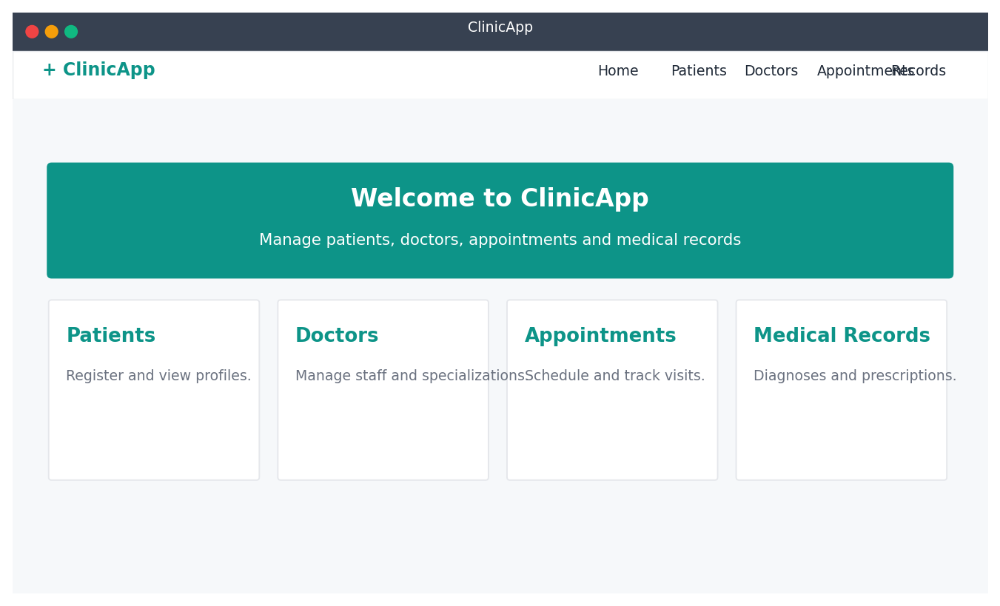
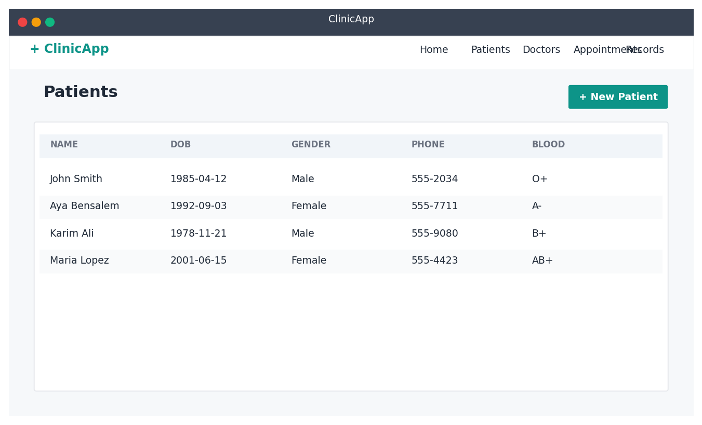
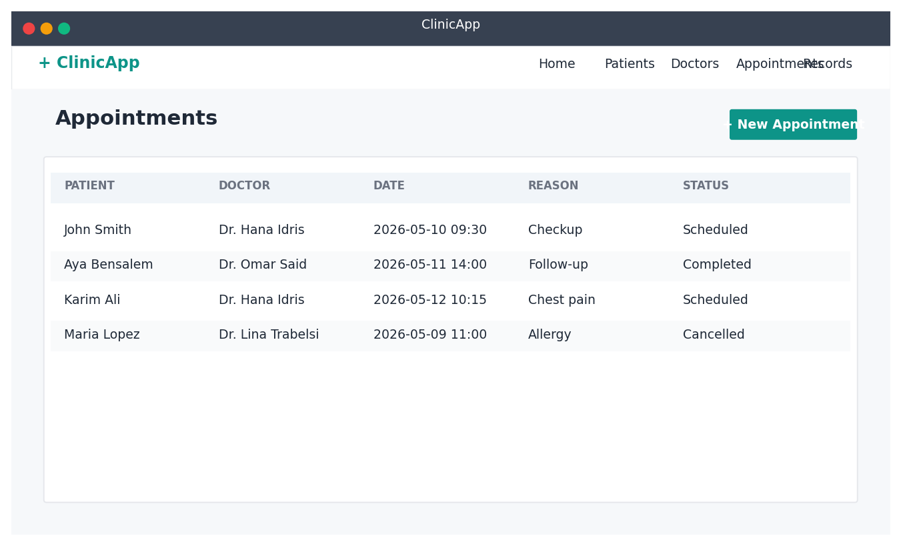
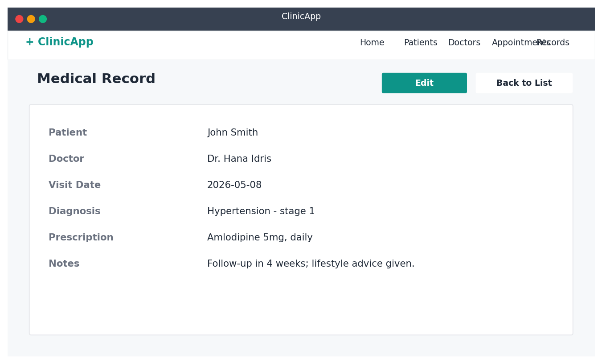
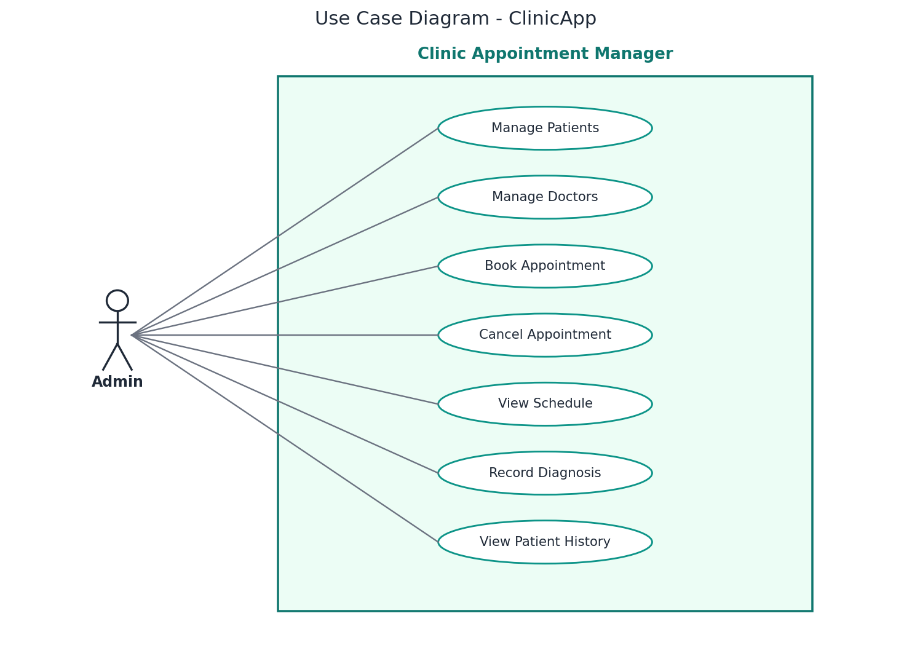
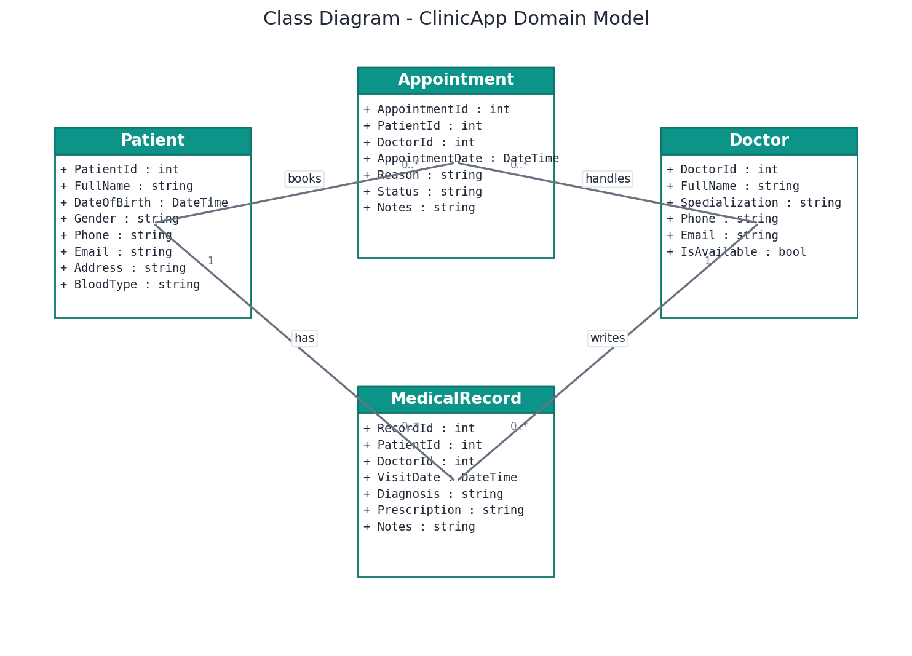

# ClinicApp - Clinic Management System

A web application for a medical clinic to manage **patients, doctors, appointments and medical records**.

**Stack:** ASP.NET Core MVC (.NET 10) · Entity Framework Core 10 (code-first + migrations) · SQL Server LocalDB · Bootstrap



## Features
- **Patients**: create, edit, view and delete patient files.
- **Doctors**: manage doctors and their specialties.
- **Appointments**: book an appointment between a patient and a doctor at a given date and time.
- **Medical records**: record diagnoses and treatments for each patient visit.
- Server-side validation with data annotations, and relationships enforced by EF Core.

| Patients | Appointments | Medical record |
|---|---|---|
|  |  |  |

## Design
| Use cases | Class diagram |
|---|---|
|  |  |

## Architecture
```
Controllers/   Patients, Doctors, Appointments, MedicalRecords, Home  (MVC controllers)
Models/        Patient, Doctor, Appointment, MedicalRecord, ClinicDbContext
Views/         Razor views (Index / Create / Edit / Details / Delete per entity)
Migrations/    EF Core code-first migrations
```

## Run it
Requirements: .NET 10 SDK and SQL Server LocalDB (installed with Visual Studio).
```bash
dotnet tool install --global dotnet-ef   # first time only
dotnet ef database update                # creates the ClinicDB database
dotnet run
```
Then open the URL shown in the console.
